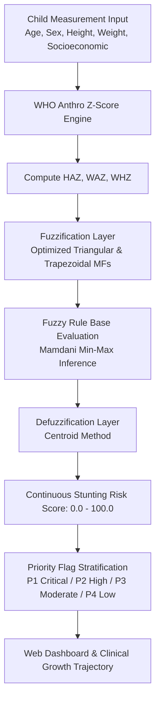

# STUNTOR: Genetic Algorithm-Optimized Fuzzy Inference System (GA-FIS) for Stunting Risk Assessment (Projects 2)

[](https://www.python.org/)
[](https://flask.palletsprojects.com/)
[-purple.svg)](https://en.wikipedia.org/wiki/Genetic_algorithm)
[](https://www.who.int/tools/child-growth-standards)
[](LICENSE)

An intelligent clinical decision-support platform that integrates **WHO Anthro Z-Score standards** with a **Genetic Algorithm-Optimized Fuzzy Inference System (GA-FIS)**. Designed to assess, prioritize, and monitor toddler stunting risk through continuous membership grading and automated triage flag stratification.

---

## Table of Contents
1. [Executive Summary](#executive-summary)
2. [Key Features](#key-features)
3. [System Architecture](#system-architecture)
4. [Methodological Framework](#methodological-framework)
5. [Genetic Algorithm Parameter Tuning](#genetic-algorithm-parameter-tuning)
6. [Directory Structure](#directory-structure)
7. [Installation & Setup](#installation--setup)
8. [Execution Guide](#execution-guide)
9. [Clinical Output & Evaluation](#clinical-output--evaluation)
10. [Author & Attribution](#author--attribution)

---

## Executive Summary

Conventional stunting diagnoses rely strictly on crisp cut-off points (e.g., $HAZ < -2.0$ SD), often failing to capture boundary uncertainties where a child at $-1.95$ SD is clinically at severe nutritional vulnerability despite falling within the normal threshold. **STUNTOR** overcomes this limitation by implementing a Mamdani-style Fuzzy Inference System whose membership function parameters are optimized via a Genetic Algorithm (GA) against empirical clinical distributions.

The platform provides:
1. **Accurate Anthropometric Z-Score Computing**: Real-time evaluation of Height-for-Age (HAZ), Weight-for-Age (WAZ), and Weight-for-Height (WHZ) according to WHO Child Growth Standards.
2. **GA-Tuned Fuzzy Engine**: Dynamic linguistic variables (Low, Moderate, High, Severe Risk) optimized to minimize misclassification loss.
3. **Full-Featured Clinical Web Platform**: Flask-based interface with longitudinal growth trajectory charts, historical evaluation logs, and automated triage priority flags (P1 Critical, P2 Urgent, P3 Routine).

---

## Key Features

- **WHO Anthro Engine**: Deterministic calculation of Z-scores utilizing age-in-months and gender-specific LMS growth curves.
- **GA-Optimized Membership Functions**: Replaces arbitrary expert guessing with genetic evolutionary search to find optimal triangular/trapezoidal fuzzy bounds.
- **Priority Flag Distribution**: Automatically categorizes toddlers into clinical urgency tiers to assist Posyandu and Puskesmas workers in allocating nutritional intervention packages.
- **Interactive Growth Trajectories**: Visualizes child measurements directly on standard WHO percentile curves.
- **Comprehensive Academic Documentation**: Includes publication drafts and research manuscripts across theoretical foundation, methodology, and experimental results.

---

## System Architecture



---

## Methodological Framework

### 1. WHO Anthro Z-Score Computation
Standard Deviation (Z-score) is calculated as:

$$Z = \frac{\left(\frac{y}{M}\right)^L - 1}{L \cdot S} \quad (L \neq 0)$$

Where $y$ is the observed measurement, $M$ is the median, $S$ is the coefficient of variation, and $L$ is the Box-Cox transformation power parameter from WHO tables.

### 2. GA Optimization of Fuzzy Sets
The Genetic Algorithm optimizes the chromosome vector $\theta = \{a_1, b_1, c_1, \dots, a_k, b_k, c_k\}$ representing the vertices of the fuzzy sets. The fitness function minimizes the mean squared error and false-negative penalties:

$$\text{Fitness}(\theta) = \frac{1}{1 + \frac{1}{N} \sum_{i=1}^N \left( y_i - \hat{y}_i(\theta) \right)^2 + \lambda \cdot \text{FN}_{\text{penalty}}}$$

---

## Directory Structure

```
Projects2/
├── .venv/                      # Python virtual environment
├── mainprogram/
│   ├── fuzzytrain_v2_defaults.py # Default parameters and model configurations
│   ├── history/                # Saved clinical diagnostic histories
│   └── svg/                    # Dynamic vector graphics for growth curves
├── node_modules/               # Supporting frontend assets
├── package.json                # Web asset configuration
└── train/
    ├── confusionmatrix.py      # Classification matrix validation
    ├── fuzzytrainv2.py         # Genetic algorithm fuzzy optimizer script
    ├── growthtrajectory.py     # WHO growth trajectory visualizer
    ├── labeldistribution.py    # Class balance and distribution scripts
    └── priorityflagdistribution.py # Triage priority distribution analyzer
```

---

## Installation & Setup

```bash
# Clone the repository
git clone https://github.com/gerrardgs/Projects2.git
cd Projects2

# Set up virtual environment
python3 -m venv .venv
source .venv/bin/activate

# Install dependencies
pip install flask numpy pandas scipy matplotlib seaborn scikit-fuzzy
```

---

## Execution Guide

### 1. Running the GA Fuzzy Training & Optimization
```bash
cd train
python3 fuzzytrainv2.py
```
This evolves fuzzy membership thresholds across successive generations and saves optimal parameter bounds.

### 2. Validating Triage Priority Distributions
```bash
python3 priorityflagdistribution.py
python3 confusionmatrix.py
```

### 3. Launching the Web Platform
```bash
cd ../mainprogram
python3 fuzzytrain_v2_defaults.py
```

---

## Clinical Output & Evaluation

- **Defuzzified Risk Score**: Scaled continuous value from $0.0$ (Zero Risk) to $100.0$ (Severe Chronic Malnutrition).
- **Triage Priority Stratification**:
  - **P1 (Critical, Risk > 75.0)**: Immediate pediatric referral, therapeutic feeding program, micronutrient supplementation.
  - **P2 (High, 50.0 - 75.0)**: Bi-weekly Posyandu monitoring, intensive dietary counseling, sanitation review.
  - **P3 (Moderate, 25.0 - 50.0)**: Monthly growth tracking, balanced nutritional food education.
  - **P4 (Low / Normal, < 25.0)**: Standard preventative health routine.

---

## Author & Attribution

- **Developer & Researcher**: Gerrard Sebastian (`sinitygsxy`)
- **Email**: `gerrardsebastiangege2005@gmail.com`
- **GitHub**: [github.com/gerrardgs](https://github.com/gerrardgs)
