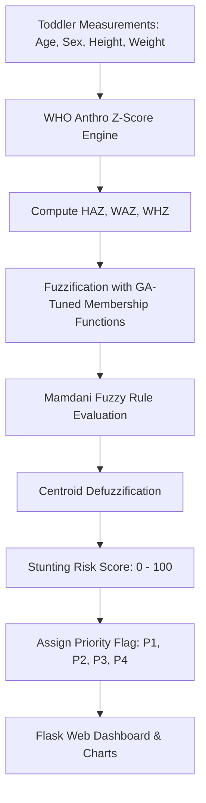

# STUNTOR: Genetic Algorithm-Tuned Fuzzy Inference System for Stunting Assessment (Projects 2)

[](https://www.python.org/)
[](https://flask.palletsprojects.com/)
[](https://en.wikipedia.org/wiki/Genetic_algorithm)
[](https://www.who.int/tools/child-growth-standards)
[](LICENSE)

A clinical decision-support web application combining WHO Anthro Z-Score standards with a Genetic Algorithm-tuned Fuzzy Inference System (GA-FIS). The system estimates child stunting risk and prioritizes toddlers for medical checkups and nutrition programs.

---

## Overview

Clinical stunting diagnosis usually depends on strict cut-offs (e.g. HAZ < -2.0 SD). In practice, toddlers with Z-scores near the threshold (such as -1.95 SD) also face high nutritional risks that strict rules can miss. **STUNTOR** addresses this problem using a Mamdani Fuzzy Inference System whose membership functions are optimized via Genetic Algorithms.

The platform provides:
1. **WHO Growth Standards Calculation**: Computes Height-for-Age (HAZ), Weight-for-Age (WAZ), and Weight-for-Height (WHZ) according to WHO guidelines.
2. **GA-Tuned Fuzzy Engine**: Finds optimal fuzzy membership boundaries to improve classification accuracy across borderline cases.
3. **Web Interface (Flask)**: Displays individual growth trajectories, assessment logs, and triage flags (P1 Critical, P2 High, P3 Moderate, P4 Normal).

---

## Features

- **WHO Anthro Engine**: Calculates standard deviation scores using LMS curve parameters by age and sex.
- **Genetic Algorithm Optimization**: Tunes triangular and trapezoidal membership points automatically based on validation data.
- **Triage Priority Stratification**: Categorizes cases into four action levels to assist community health centers in allocating food assistance.
- **Growth Chart Visualizations**: Plots measurements directly on WHO growth curves.
- **Documented Research Papers**: Includes research drafts and experimental notes detailing the methodology.

---

## System Workflow



### Z-Score Formula
Standard deviation scores are calculated using WHO parameters:

$$Z = \frac{\left(\frac{y}{M}\right)^L - 1}{L \cdot S} \quad (L \neq 0)$$

Where $y$ is the child's measurement, $M$ is the median, $S$ is the coefficient of variation, and $L$ is the Box-Cox power transformation.

---

## Project Structure

```
Projects2/
├── .venv/                      # Python virtual environment
├── mainprogram/
│   ├── fuzzytrain_v2_defaults.py # Default parameters and application runner
│   ├── history/                # Saved assessment records
│   └── svg/                    # Growth curve chart templates
├── train/
    ├── confusionmatrix.py      # Classification matrix evaluation
    ├── fuzzytrainv2.py         # Genetic algorithm fuzzy optimizer
    ├── growthtrajectory.py     # Growth trajectory plotter
    ├── labeldistribution.py    # Class balance checker
    └── priorityflagdistribution.py # Priority distribution analysis
```

---

## Installation & Setup

```bash
git clone https://github.com/gerrardgs/Projects2.git
cd Projects2

python3 -m venv .venv
source .venv/bin/activate

pip install flask numpy pandas scipy matplotlib seaborn scikit-fuzzy
```

---

## Running the Code

### 1. Optimize Membership Functions with GA
```bash
cd train
python3 fuzzytrainv2.py
```

### 2. Check Results and Confusion Matrix
```bash
python3 priorityflagdistribution.py
python3 confusionmatrix.py
```

### 3. Launch Web App
```bash
cd ../mainprogram
python3 fuzzytrain_v2_defaults.py
```

---

## Risk Score & Action Tiers

- **P1 (Score > 75.0)**: Critical - Immediate pediatric referral and therapeutic food package.
- **P2 (Score 50.0 - 75.0)**: High Risk - Bi-weekly Posyandu checks and dietary counseling.
- **P3 (Score 25.0 - 50.0)**: Moderate Risk - Monthly growth tracking and balanced nutrition guidance.
- **P4 (Score < 25.0)**: Normal - Standard health routine.

---

## Author

- Gerrard Sebastian (`sinitygsxy`)
- Email: gerrardsebastiangege2005@gmail.com
- GitHub: [github.com/gerrardgs](https://github.com/gerrardgs)
